

  <picture>
    <source media="(prefers-color-scheme: dark)" srcset="../assets/banner-dark.svg">
    <source media="(prefers-color-scheme: light)" srcset="../assets/banner-light.svg">
    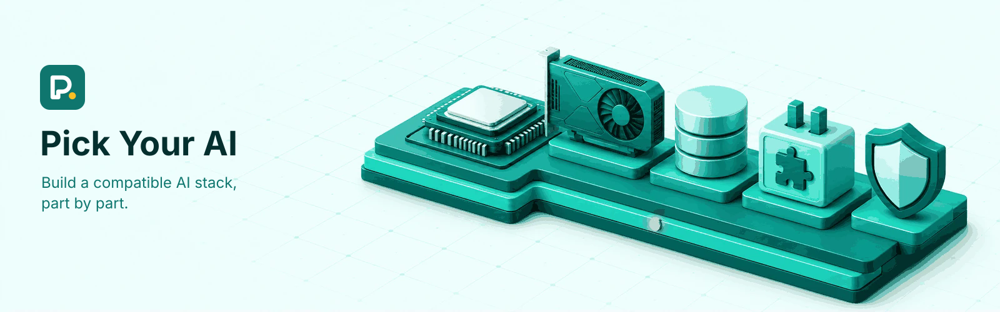
  </picture>

  
  
  

  <a href="https://github.com/Pick-Your-AI/pick-your-ai-website">Application</a> ·
  <a href="https://github.com/Pick-Your-AI/pick-your-ai-research">Research</a> ·
  <a href="https://github.com/Pick-Your-AI/pick-your-ai-android">Android</a> ·
  <a href="https://github.com/Pick-Your-AI/pick-your-ai-apple">Apple/iOS</a> ·
  <a href="https://github.com/Pick-Your-AI/pick-your-ai-leaderboard">Leaderboard plan</a> ·
  <a href="https://github.com/Pick-Your-AI/pick-your-ai-website/blob/main/LICENSE">MIT licence</a>

> [!NOTE]
> **Preview status.** The application is available as a preview. Its components, prices, and compatibility results use synthetic demonstration data. The real component catalog is still being researched; preview results are not validated recommendations or current vendor quotes.

## Get involved

Explore the [volunteer hub](https://github.com/Pick-Your-AI/pick-your-ai-volunteers) for public-safe applications, opportunities, staffing readiness and onboarding. Pick Your AI intends to pursue US 501(c)(3) status; this volunteer program does not establish incorporation, tax exemption or tax-deductible donation eligibility.

<table>
<tr>
<td width="33%" valign="top">
<h3>Research</h3>
<ol>
<li>Read the <a href="https://github.com/Pick-Your-AI/pick-your-ai-research/blob/main/CONTRIBUTING.md">contribution guide</a></li>
<li>Choose an existing issue on the <a href="https://github.com/orgs/Pick-Your-AI/projects/1">research board</a></li>
<li>Follow the <a href="https://github.com/Pick-Your-AI/pick-your-ai-research/blob/main/docs/RESEARCH_WORKFLOW.md">submission workflow</a></li>
</ol>
Preserve the issue's deliverable path and coordinate with its live assignees. Keep incomplete findings in notes; never invent facts to fill a schema.
</td>
<td width="33%" valign="top">
<h3>Application</h3>
<ol>
<li>Read the <a href="https://github.com/Pick-Your-AI/pick-your-ai-website/blob/main/CONTRIBUTING.md">application contribution guide</a></li>
<li>Link implementation work to its research counterpart</li>
<li>Propose contract changes in <a href="https://github.com/Pick-Your-AI/pick-your-ai-research/issues/40">research issue #40</a></li>
</ol>
</td>
<td width="33%" valign="top">
<h3>Recognition</h3>
<ol>
<li>Start with the <a href="https://github.com/orgs/Pick-Your-AI/projects/6">leaderboard delivery project</a></li>
<li>Read the <a href="https://github.com/Pick-Your-AI/pick-your-ai-leaderboard">repository guidance</a></li>
</ol>
Contributions remain in their owning repositories; leaderboard work links to that evidence.
</td>
</tr>
</table>

Everyone follows our [Code of Conduct](https://github.com/Pick-Your-AI/.github/blob/main/CODE_OF_CONDUCT.md). Report security concerns privately through the affected repository's security policy; the research repository's [security policy](https://github.com/Pick-Your-AI/pick-your-ai-research/blob/main/SECURITY.md) describes its process. Do not post credentials, personal data, or vulnerability details in public issues.

## What is Pick Your AI?

Pick Your AI is a web-based builder for assembling a complete AI solution, like a PC build. Start with a workload and deployment mode, then choose models, infrastructure, and optional capabilities. The goal is to help people understand compatibility, costs, and tradeoffs, with evidence behind each recommendation.

[PCPartPicker](https://pcpartpicker.com/list/) is a functional reference; Pick Your AI develops its own brand, interface, and code.

## The problem

Model licences, context limits, GPU memory, inference-engine support, hosting availability, retrieval, tool permissions and pricing constrain each other. A model may not fit a GPU; an engine may not support a format; a hosting region may not offer the hardware. We aim to make these relationships and their evidence easier to inspect.

## Seven tiers

The configurator is intended to guide users through seven tiers. T3 to T5 are optional and can be left out entirely.

| | Tier | Focus |
| --- | --- | --- |
| 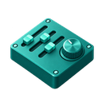 | **T0** Configuration | Workload / use case and deployment mode (API, managed, self-hosted, hybrid) |
| 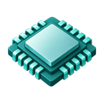 | **T1** Model Selection | Provider, model, context window |
| 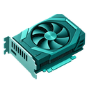 | **T2** Infrastructure | Hosting, GPU / compute, inference engine |
| 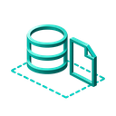 | **T3** Knowledge & Retrieval *(optional)* | Knowledge base, embeddings, vector database, RAG |
| 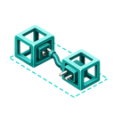 | **T4** Agents & Integrations *(optional)* | Agent framework, tools and APIs, MCP servers, memory |
| 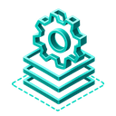 | **T5** Training & Fine-Tuning *(optional)* | Training framework, compute, dataset, fine-tuned model |
|  | **T6** Deployment & Operations | Guardrails, evaluation, deployment, monitoring, cost estimate |

Tiers constrain each other in both directions: models affect GPU requirements, and GPU availability limits model choices. The intended compatibility system re-checks affected selections when a component changes, and never treats unknown compatibility as compatible.

## Where the work happens

<table>
<tr>
<td width="33%" valign="top">
<a href="https://github.com/Pick-Your-AI/pick-your-ai-website">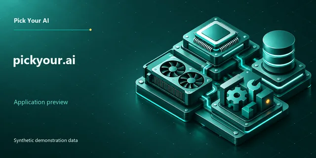</a> 
<b><a href="https://github.com/Pick-Your-AI/pick-your-ai-website">pick-your-ai-website</a></b> 
Application, interface, tests, and data integration
</td>
<td width="33%" valign="top">
<a href="https://github.com/Pick-Your-AI/pick-your-ai-research">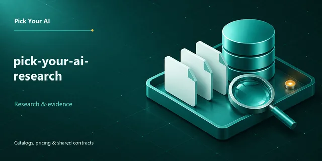</a> 
<b><a href="https://github.com/Pick-Your-AI/pick-your-ai-research">pick-your-ai-research</a></b> 
Evidence, decision records, catalog and pricing proposals, and shared contracts
</td>
<td width="33%" valign="top">
<a href="https://github.com/Pick-Your-AI/pick-your-ai-leaderboard">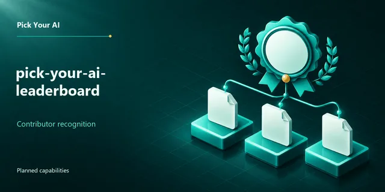</a> 
<b><a href="https://github.com/Pick-Your-AI/pick-your-ai-leaderboard">pick-your-ai-leaderboard</a></b> 
Contributor recognition, metric definitions, and leaderboard delivery planning
</td>
</tr>
<tr>
<td width="33%" valign="top">
<a href="https://github.com/Pick-Your-AI/pick-your-ai-android">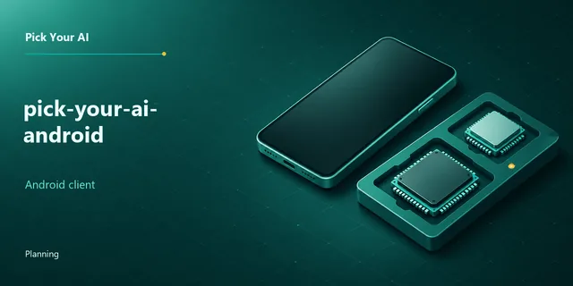</a> 
<b><a href="https://github.com/Pick-Your-AI/pick-your-ai-android">pick-your-ai-android</a></b> 
Android planning client: scope, contribution guidance, and delivery planning
</td>
<td width="33%" valign="top">
<a href="https://github.com/Pick-Your-AI/pick-your-ai-apple">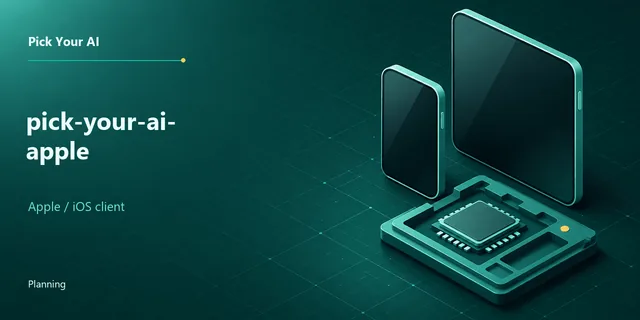</a> 
<b><a href="https://github.com/Pick-Your-AI/pick-your-ai-apple">pick-your-ai-apple</a></b> 
Apple/iOS planning client: scope, contribution guidance, and delivery planning
</td>
<td width="33%" valign="top">
<a href="https://github.com/Pick-Your-AI/.github">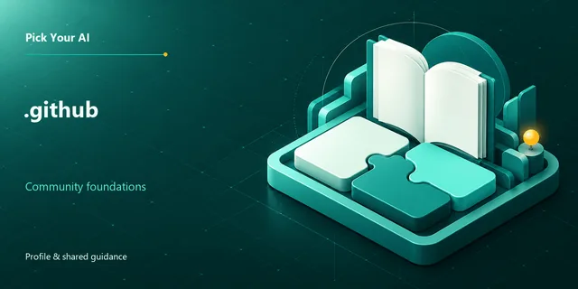</a> 
<b><a href="https://github.com/Pick-Your-AI/.github">.github</a></b> 
Organization profile and community defaults
</td>
</tr>
</table>

Application, research and leaderboard work have separate workflows. Funding, grants and sustainability work is coordinated in [pick-your-ai-sustainability](https://github.com/Pick-Your-AI/pick-your-ai-sustainability), tracked in [Project 7](https://github.com/orgs/Pick-Your-AI/projects/7). The application demonstrates selection with synthetic fixtures. Research gathers sourced facts, dated prices and proposed compatibility rules under a versioned shared contract. **Merged research does not automatically become production catalog data.**

The mobile repositories are early-stage and unreleased. Android has a Kotlin/JVM core and an unsigned debug diagnostic; Apple/iOS has an unsigned SwiftUI app with local drafts. Neither has a signed installable product, production backend or release yet.

### Project boards

  
  

  
  
  
  

## Contributor recognition · Planned

The [contributor leaderboard project](https://github.com/orgs/Pick-Your-AI/projects/6) and its [delivery program](https://github.com/Pick-Your-AI/pick-your-ai-leaderboard/issues/1) plan public, source-linked recognition across pull requests, code changes, reviews, issues, triage, documentation, research, and maintenance. The plan defines **98 metrics, 20 epics, 112 work packages and 474 implementation checklist tasks**. These are planned capabilities, not a deployed leaderboard. Metric availability, historical coverage, and limitations must be visible, and lines of code do not establish contribution quality.

The [leaderboard repository](https://github.com/Pick-Your-AI/pick-your-ai-leaderboard) owns its metric definitions, delivery workflow, and correction process. Existing repository contribution and review rules continue to determine whether work is accepted.

